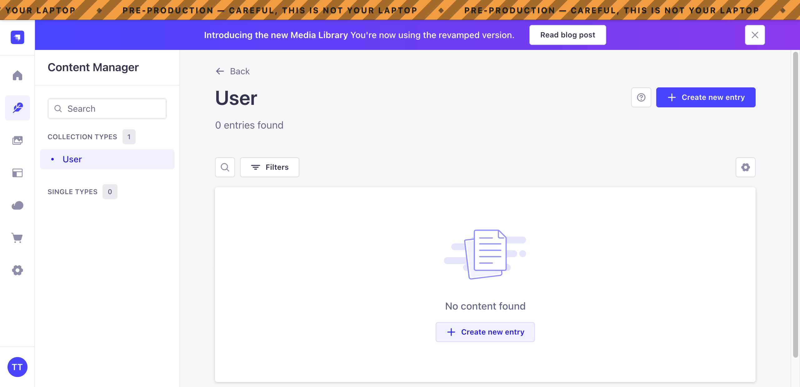
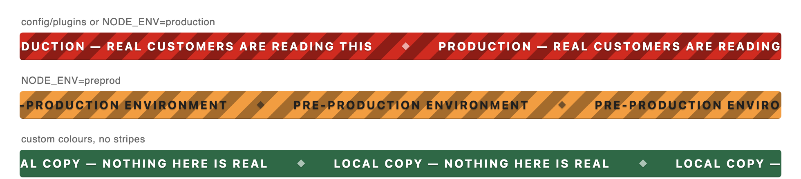
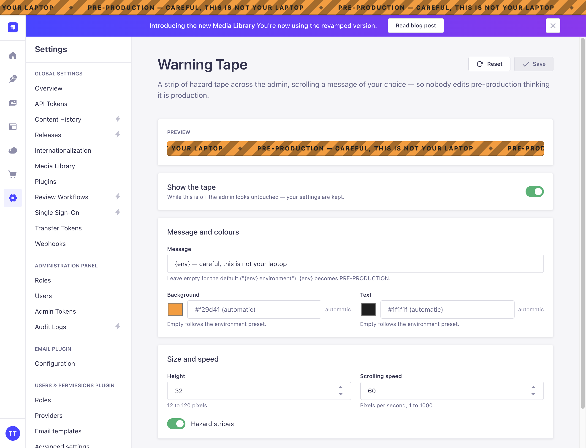
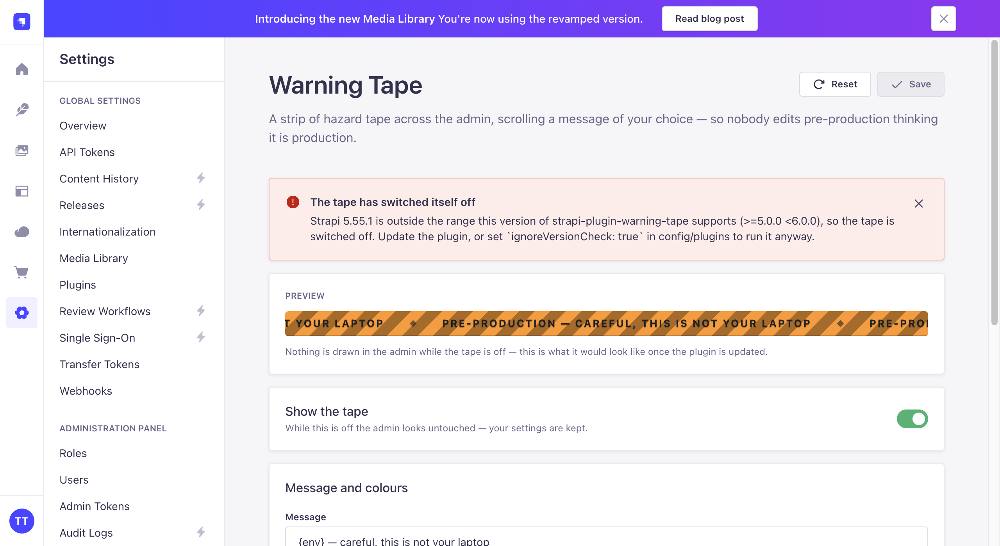

# strapi-plugin-warning-tape

A strip of hazard tape across the top of the Strapi 5 admin, scrolling a message
of your choice — so nobody edits pre-production thinking it is production.



The environment name is read from the process, not from the database: colours and
text come out right on every deployment without a per-environment build, and a
database restored from another environment cannot make production look like
staging.

## Install

```bash
npm install strapi-plugin-warning-tape
```

Nothing else is required — the tape appears on the next admin build with the
colours of the environment it detects. Strapi rebuilds the admin automatically in
development; in production run `npm run build` again after installing.

## What it shows

The environment name is the first of these that is set:

`WARNING_TAPE_ENV`, `STRAPI_ENV`, `APP_ENV`, `ENVIRONMENT`, `ENV`, `NODE_ENV` —
or `env` in `config/plugins`, which overrides all of them.

That name is matched against the presets below (aliases included: `prod`, `live`,
`pre-prod`, `preproduction`, `stage`, `uat`, `recette`, `qa`, `ci`, `testing`,
`dev`, `develop`, `localhost`):

| Environment   | Label            | Background | Text      |
| ------------- | ---------------- | ---------- | --------- |
| `production`  | `PRODUCTION`     | `#d02b20`  | `#ffffff` |
| `preprod`     | `PRE-PRODUCTION` | `#f29d41`  | `#1f1f1f` |
| `staging`     | `STAGING`        | `#f0d000`  | `#1f1f1f` |
| `test`        | `TEST`           | `#9736e8`  | `#ffffff` |
| `development` | `DEVELOPMENT`    | `#4945ff`  | `#ffffff` |
| `local`       | `LOCAL`          | `#2f6846`  | `#ffffff` |

A name that matches nothing still works: it becomes its own label
(`shopin-qa-7` → `SHOPIN-QA-7`) on a neutral yellow.



The default message is `{env} environment`. `{env}` is replaced with the label
wherever it appears, so `Careful — this is {env}, not your laptop` works too.

## Settings

**Settings → Warning Tape → Tape** in the admin, with a live preview:



- **Show the tape** — off leaves the admin untouched, your settings are kept.
- **Message** — empty means the default; `{env}` expands.
- **Background / Text** — empty means the preset for the detected environment, so
  the same setting keeps making sense on every deployment.
- **Height** (12–120px), **scrolling speed** (pixels per second) and **hazard stripes**.

That is the whole page. Where the tape sits and whether it pauses under the pointer
are decisions for a deployment, not for whoever is editing content that day, so
they live in `config/plugins` only.

These are stored in Strapi's core store, so everyone on that deployment sees the
same tape. Colours and a message you leave on "automatic" are the ones that
survive a database copied between environments — a message with `{env}` in it
will still be right, a message that spells out an environment will not.

## config/plugins

Everything the Settings page edits can be given a default in
`config/plugins.ts`, plus three options that only exist there:

```ts
export default ({ env }) => ({
  'warning-tape': {
    enabled: true,
    config: {
      // Defaults for the Settings page
      message: 'Careful — this is {env}',
      backgroundColor: null, // null = the preset for the detected environment
      textColor: null,
      speed: 60,             // pixels per second
      height: 32,
      stripes: true,

      // Only here
      position: 'top',        // or 'bottom'
      pauseOnHover: true,     // stop the marquee while the pointer is on it
      env: env('DEPLOY_ENV'), // overrides the detected environment name
      readOnly: env.bool('WARNING_TAPE_LOCKED', false),
      public: true,
    },
  },
});
```

- **`readOnly`** ignores the stored settings entirely and makes the Settings page
  read-only: the file is the tape. Worth switching on in production, where the
  banner is not something an editor should be able to turn off.
- **`ignoreVersionCheck`** (default `false`) runs the plugin on a Strapi major it
  was not written for. See *Strapi upgrades* below.
- **`public`** (default `true`) serves the banner before login, so the tape is
  there on the login screen — the moment you most want to know which environment
  you are typing a password into. It exposes nothing but the message, the colours
  and the environment name. Set it to `false` to require an admin session, and
  the tape then appears once you are logged in.

Bad values are rejected at boot with a message naming the option.

## Strapi upgrades

The plugin is written against the Strapi 5 plugin API (`>=5.0.0 <6.0.0`). On a
major upgrade it does not try its luck: it switches itself off, leaves the admin
untouched, and says why in **Settings → Warning Tape**, next to the Strapi version
it found. The server logs one line at boot:

```
warn: [warning-tape] Strapi 6.0.0 is outside the range this version of
strapi-plugin-warning-tape supports (>=5.0.0 <6.0.0), so the tape is switched off.
```



Updating the plugin is the fix. If you would rather run it anyway — the admin API
it uses may well still work — set `ignoreVersionCheck: true` in `config/plugins`.

The same applies to anything else that goes wrong. A store it cannot read, a
config route it cannot protect, an admin API that moved: each one is caught,
reported on the settings page, and costs you a banner, never a working admin.
Strapi never fails to boot, the admin never fails to render, and the settings
page explains itself rather than going blank.

## Notes

- Colours accept hex, `rgb()`, `hsl()` and CSS keywords; anything else is
  refused, both in the API and in the form.
- The tape makes room for itself (`#strapi` gets matching padding) instead of
  covering the admin, so no content is hidden and no second scrollbar appears.
- It honours `prefers-reduced-motion`: the message is centred and still.
- The message is announced once as a `role="status"` region, not on every loop.

## Development

```bash
npm install
npm run build     # bundles admin/ and server/ into dist/
npm run verify    # checks the package exports
npm run watch:link # for `npm link` into a local Strapi project
```

## License

MIT
